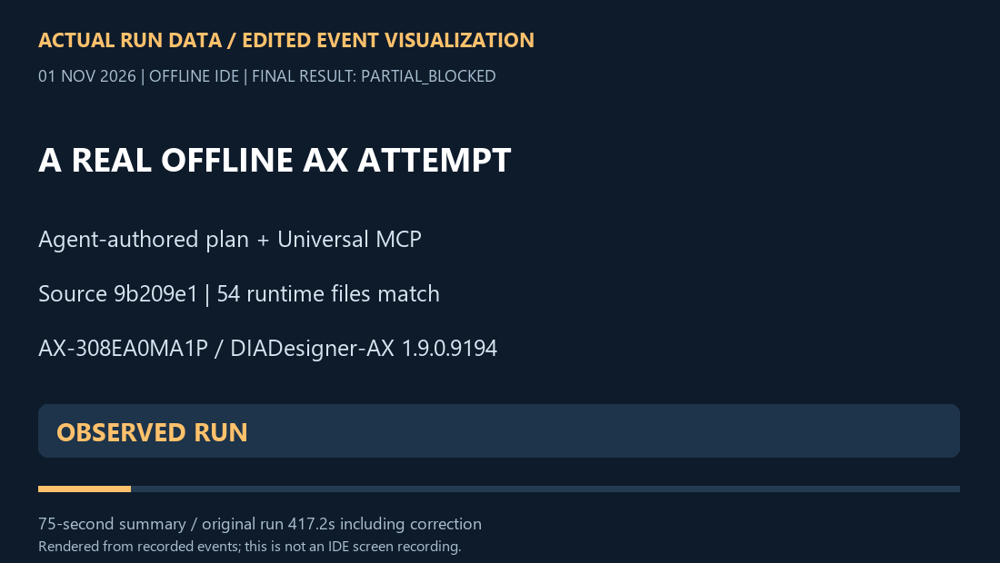

# Delta PLC Agent

**From a control requirement to an AX engineering run.**
Let your AI agent plan, create and revise a native AX project, use compiler feedback, and inspect the resulting evidence through MCP and an engineering skill.

[](https://github.com/ufukefekaya-tr/delta-plc-agent/actions/workflows/ci.yml)
[](LICENSE)
[](https://github.com/ufukefekaya-tr/delta-plc-agent/releases)
[English](README.md) · [Türkçe](README.tr.md)

[](docs/showcase/AX_DEMO.md)

**[See the real AX run](docs/showcase/AX_DEMO.md) · [Start your first task](docs/QUICKSTART.md) · [Add the engineering skill](docs/public/SKILL.md)**

### Latest AX demonstration · 1 November 2026

A new neutral offline project reached real DIADesigner-AX compiler feedback. After the agent corrected its sample, the compiler reported **0 errors / 0 compiler warnings**. The MCP's final acceptance remained **BLOCKED** by **21 missing-device-definition environment warnings**; artifact freezing was not reached. The [run page](docs/showcase/AX_DEMO.md) shows actual completed steps, the complete sanitized call index and reproduction inputs.

This is an **offline IDE run**, not a physical PLC test. One-time host/profile setup is separate from the automatic run. AX uses a hidden vendor runtime and ScriptEngine, without human menu clicks during the recorded attempt. The agent supplies the plan; `workflow.run` executes explicit typed steps.

## What would you like your agent to do?

| Your task | Model / toolchain | Start here |
|---|---|---|
| Create/revise an AX project and inspect native compiler results | Exact AX device/profile on a Windows DIADesigner-AX host | [Neutral AX run and evidence](docs/showcase/AX_DEMO.md) |
| Inspect or patch supported ISP source; work with POU/library packages | Compatible AS/DVP formats through ISPSoft file tools | [File operations](docs/adapters/delta-files.md) |
| Try IL→MPU→IL without an IDE or PLC | Supported DVP file conversion on a Python host | [No-IDE example](#try-the-no-ide-example) |
| Read identity/status, observe or use profile-bound M/D operations | `DVP14SS211R`, DVP serial adapter, current target authority | [DVP job runbook](docs/DVP_AGENT_RUNBOOK.md) |
| Work in WPLSoft and observe with MCP | Model-compatible WPLSoft UI workflow + serial MCP | [WPLSoft/DVP workflow](docs/DVP_AGENT_RUNBOOK.md) |

Model families are not blanket qualification for every device or operation. [Exact catalog](catalog/README.md) · [Feature and qualification map](docs/FEATURES.md).

## Connect MCP + skill

Install in a Python 3.11+ virtual environment from a source checkout:

```bash
git clone https://github.com/ufukefekaya-tr/delta-plc-agent.git
cd delta-plc-agent
python -m venv .venv
```

Activate the environment for your shell, then `python tools/install.py`. Start the common server with your installed interpreter:

```bash
python -m universal_plc --root ./plc-agent-data serve
```

Use that interpreter and those arguments in your MCP client. Add the complete [Delta PLC engineering skill](skills/delta-plc-engineering/SKILL.md) directory to your client's skill location. The MCP remains independently usable. [Client JSON, host prerequisites and first prompts](docs/QUICKSTART.md).

**First native AX task:**

> Use the Delta PLC engineering skill and the configured AX adapter. Inspect the exact model, IDE profile and capabilities. Plan a new neutral offline project with no physical I/O. Create it, apply the called ST program, save/reopen/read back, build with the vendor compiler and inspect every diagnostic. Bind results to the current revision. Stop at a failed acceptance gate and report the actual completed steps. Do not connect to a PLC.

AX native work requires the matching Windows vendor installation and host-local configuration. A Python/server-only installation can use the file workflows; [native preparation is explicit](docs/showcase/AX_DEMO.md#reproduce).

## Try the no-IDE example

```bash
python tools/demo.py
```

This small IL↔MPU example selects a DVP target, creates an isolated workspace and verifies file-transform evidence. It needs no vendor IDE or PLC. For a compact installation use `python tools/install.py --profile dvp`. This file demonstration is separate from the native AX run above.

## Engineering you can inspect

- **Model-aware tools.** Eleven common MCP tools route targets, inspect capabilities and manage workspaces, operations, workflows and evidence.
- **A continuing engineering record.** Source/revision hashes, durable jobs, save/reopen/readback and explicit recovery/reconciliation paths.
- **AX tooling.** Project creation, ST/Ladder revisions, build/job orchestration, artifact and deployment contracts; exact operation qualification stays visible.
- **A reusable method.** Analyst, architect, programmer, verifier, independent reviewer and Kaizen roles; W1–W7 workflows, checkpoints and model-aware skill guidance.
- **Portable ownership.** Host-local project/tool paths and Python adapter entry points; no customer project or developer machine binding in the package.

[Architecture and tool contracts](docs/UNIVERSAL_RUNTIME.md) · [Skills and dynamic goals](docs/plans/plc-skill/PLAN.md) · [AX lessons](backends/ax/docs/AX_LESSONS.md) · [Roadmap](docs/ROADMAP.md).

## Evidence and contribution

The [new showcase](docs/showcase/AX_DEMO.md) adds a dated run; it does not rewrite the [historical AX0.4 validation](docs/public/AX_0_4_VALIDATION.md) or the [11 October native-chain result](backends/ax/qualification/native-public-chain-2026-10-11.json). Software checks, native IDE results and physical target acceptance are separate.

Bring a neutral example, model qualification, documentation improvement or adapter. [Contributing](CONTRIBUTING.md) · [Issues](https://github.com/ufukefekaya-tr/delta-plc-agent/issues) · [Presentation study](docs/showcase/PRESENTATION_RESEARCH.md) · [Launch kit](docs/public/LAUNCH.md).

Also explore the complementary [Universal Delta HMI Agent](https://github.com/ufukefekaya-tr/universal-delta-hmi-agent), with its own MCP, skill and file-engineering evidence. [Glama directory listing](https://glama.ai/mcp/servers/ufukefekaya-tr/delta-plc-agent).

Created by **[ufukefekaya-tr](https://github.com/ufukefekaya-tr)**. Core, AX backend and PLC skill: [MIT](LICENSE). [Third-party credits](THIRD_PARTY_NOTICES.md) · [Agent index](INDEX.md) · [Security](SECURITY.md).
