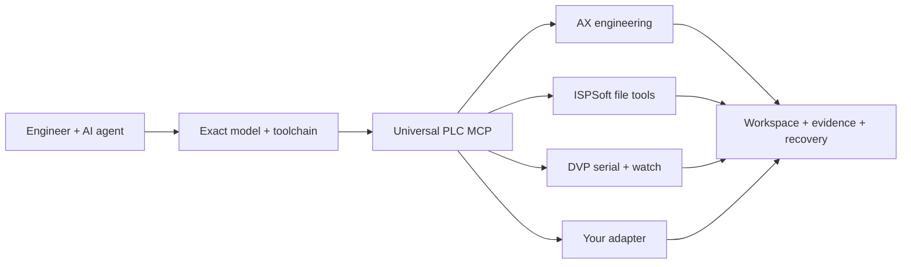

# Delta PLC Agent

**AI-powered engineering for Delta PLCs — AX, ISPSoft and WPLSoft workflows through one MCP.**
One MCP. Model-aware workflows. Traceable results.

[](https://github.com/ufukefekaya-tr/delta-plc-agent/actions/workflows/ci.yml)
[](LICENSE)
[](docs/QUICKSTART.md)
[English](README.md) · [Türkçe](README.tr.md)

Bring AI agents into PLC engineering: select the right tools for an exact target, work in isolated project copies, and keep a verifiable record of every operation. Delta PLC Agent connects a vendor-neutral MCP core with AX engineering tools, ISPSoft transformations, DVP monitoring, and reusable agent workflows.

**[Run the demo](#try-it) · [Connect your agent](docs/QUICKSTART.md) · [Explore every feature](docs/FEATURES.md)**



## Why Delta PLC Agent

- **One entry point for your agent.** Eleven MCP tools cover target selection, capabilities, workspaces, adapter operations, evidence, and workflows.
- **Engineering with context.** Bind changes to the exact model, source hash, task, and revision. Resume from durable records after an interruption.
- **A toolkit that travels.** Install the same source on your workstation or server; configure project roots and vendor tooling on that host.
- **A team, not just a prompt.** Analyst, architect, programmer, verifier, tenth-man reviewer, and Kaizen curator roles give agents a shared engineering process.
- **Room to grow.** Register vendor adapters through Python entry points and extend the catalog without changing the core workflow interface.

## Try it

With Python 3.11+ and Git:

```bash
git clone https://github.com/ufukefekaya-tr/delta-plc-agent.git
cd delta-plc-agent
python -m venv .venv
```

Activate `.venv` with its activation script for your shell, then:

```bash
python tools/install.py
python tools/demo.py
```

The demo routes a DVP target, creates an isolated workspace, converts a tiny instruction list to MPU and back, and verifies its evidence records. **No IDE or PLC is needed.** Use `python tools/install.py --profile dvp` for the compact DVP/ISPSoft package.

## Engineering paths

| Path | What you can explore |
|---|---|
| **Universal MCP** | Exact-model routing, capability discovery, hash-bound imports, persistent workspaces, evidence and W1–W7 workflows |
| **Delta AX** | Project creation, ST/Ladder tooling, build and job orchestration, source readback, artifact and deployment contracts |
| **ISPSoft files** | Supported ISP container inspection, existing ST/variable patching, POU/library packages, DVP IL↔MPU and template-based generation |
| **DVP serial** | ASCII/DirectLink CDC, identity/status reads, profile-bound M/D commands and parameters, observation and reconciliation for `DVP14SS211R` |
| **WPLSoft agent workflow** | Computer Use recipe for project editing, compilation and requested download, paired with MCP online observation |
| **Agent engineering** | Six roles, behavior contracts, independent review, checkpoints, goals and reusable Kaizen lessons |

[Detailed feature map and qualifications](docs/FEATURES.md) · [Architecture](docs/UNIVERSAL_RUNTIME.md) · [Roadmap](docs/ROADMAP.md)

## Connect your agent

Start a stdio server with the Python environment where you installed Delta PLC Agent:

```bash
python -m universal_plc --root ./plc-agent-data serve
```

Point your MCP client's command at that environment's Python interpreter and use the arguments above. Give your agent [AGENTS.md](AGENTS.md) and [INDEX.md](INDEX.md) as its engineering entrypoints. [Client configuration and a first prompt](docs/QUICKSTART.md).

## Build with us

Bring an adapter, a reproducible model qualification, an example, or a documentation improvement. Start with [CONTRIBUTING](CONTRIBUTING.md) and [the public launch workflow](workflows/public-launch.json).

[Workflows](workflows/README.md) · [Goals](goals/README.md) · [Agent-readable index](llms.txt) · [Validation](docs/public/VALIDATION.md) · [Security](SECURITY.md) · [Launch kit](docs/public/LAUNCH.md)

Created and maintained by **[ufukefekaya-tr](https://github.com/ufukefekaya-tr)**. Core and AX backend: [MIT](LICENSE). [Third-party authors and licenses](THIRD_PARTY_NOTICES.md) remain credited. Cite the project with [CITATION.cff](CITATION.cff).

## ISPSoft update — 2026-10-26

[AS v3010 codec, current Windows source layer and qualification limits](docs/adapters/ispsoft-lab.md). The public core retains eleven MCP tools; the separate source layer has its own project profile and acceptance evidence.
