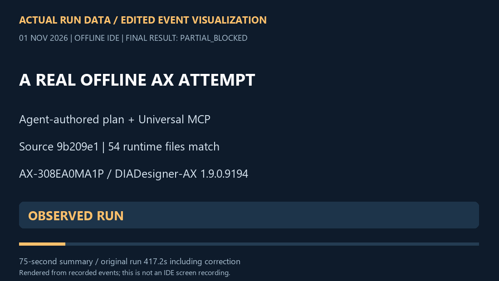

# Delta PLC Agent

**Kontrol ihtiyacından AX mühendislik akışına.**
AI ajanınız MCP ve mühendislik skill'iyle yerel AX projesini planlasın, oluştursun, düzenlesin; compiler geri bildirimini ve işlem kanıtını incelesin.

[](https://github.com/ufukefekaya-tr/delta-plc-agent/actions/workflows/ci.yml)
[](LICENSE)
[](https://github.com/ufukefekaya-tr/delta-plc-agent/releases)
[English](README.md) · Türkçe

[](docs/showcase/AX_DEMO.md)

**[Gerçek AX koşusunu inceleyin](docs/showcase/AX_DEMO.md) · [İlk görevinize başlayın](docs/QUICKSTART.md) · [Mühendislik skill'ini ekleyin](docs/public/SKILL.md)**

### Yeni AX gösterimi · 1 Kasım 2026

Yeni ve nötr çevrimdışı proje, gerçek DIADesigner-AX compiler geri bildirimine ulaştı. Ajan örneğini düzelttikten sonra compiler **0 hata / 0 compiler uyarısı** bildirdi. MCP'nin son kabulü, **21 eksik cihaz tanımı ortam uyarısı** nedeniyle **BLOCKED** kaldı; artifact sabitleme aşamasına geçilmedi. [Koşu sayfasında](docs/showcase/AX_DEMO.md) gerçekleşen adımlar, tam arındırılmış çağrı indeksi ve tekrar üretim girdileri var.

Bu bir **çevrimdışı IDE koşusudur**; fiziksel PLC testi değildir. İlk host/profil hazırlığı otomatik koşudan ayrıdır. AX, gizli vendor runtime ve ScriptEngine ile çalışır; kaydedilen denemede insan menü tıklaması yoktur. Planı ajan üretir; `workflow.run` açık typed adımları yürütür.

## Ajanınız hangi işi yapsın?

| Görev | Model / araç | Başlangıç |
|---|---|---|
| AX projesi oluşturma/revizyon ve native compiler sonucunu inceleme | Windows DIADesigner-AX üzerinde exact AX cihaz/profil | [Nötr AX koşusu ve kanıt](docs/showcase/AX_DEMO.md) |
| Desteklenen ISP kaynağını inceleme/düzenleme, POU/kütüphane paketleri | ISPSoft dosya araçlarıyla uyumlu AS/DVP biçimleri | [Dosya işlemleri](docs/adapters/delta-files.md) |
| IDE ve PLC olmadan IL→MPU→IL denemesi | Python host üzerinde desteklenen DVP dosya dönüşümü | [IDE gerektirmeyen örnek](#ide-gerektirmeyen-örnek) |
| Kimlik/durum, izleme ve profil bağlı M/D işlemleri | `DVP14SS211R`, seri adaptör ve güncel hedef yetkisi | [DVP görev rehberi](docs/DVP_AGENT_RUNBOOK.md) |
| WPLSoft'ta çalışma ve MCP ile gözlem | Modele uygun WPLSoft arayüz akışı + seri MCP | [WPLSoft/DVP iş akışı](docs/DVP_AGENT_RUNBOOK.md) |

Aile adı her model ve işlemin doğrulandığı anlamına gelmez. [Exact katalog](catalog/README.md) · [Özellik ve doğrulama haritası](docs/FEATURES.md).

## MCP + skill bağlantısı

Python 3.11+ sanal ortamı için:

```bash
git clone https://github.com/ufukefekaya-tr/delta-plc-agent.git
cd delta-plc-agent
python -m venv .venv
```

Ortamı kullandığınız kabuğa göre etkinleştirip `python tools/install.py` çalıştırın. Ortama kurduğunuz Python ile ortak MCP'yi başlatın:

```bash
python -m universal_plc --root ./plc-agent-data serve
```

MCP istemcinizde bu interpreter ve argümanları kullanın. Tam [Delta PLC mühendislik skill klasörünü](skills/delta-plc-engineering/SKILL.md) istemcinizin skill konumuna ekleyin. MCP tek başına da kullanılabilir. [İstemci JSON'u, host gereksinimleri ve ilk görevler](docs/QUICKSTART.md).

**İlk native AX görevi:**

> Delta PLC mühendislik skill'ini ve yapılandırılmış AX adaptörünü kullan. Exact model, IDE profili ve yetenekleri incele. Fiziksel I/O içermeyen yeni nötr çevrimdışı proje planla. Projeyi oluştur; çağrılan ST programını uygula, kaydet/yeniden aç/geri oku, vendor compiler ile derle ve bütün teşhisleri incele. Sonucu güncel revizyona bağla. Kabul kapısı başarısızsa dur ve gerçekleşen adımları bildir. PLC'ye bağlanma.

Native AX işlemi, uygun Windows vendor kurulumu ve host yapılandırması gerektirir. Python/sunucu kurulumu dosya yollarını kullanabilir; [native hazırlık açıkça tanımlıdır](docs/showcase/AX_DEMO.md#reproduce).

## IDE gerektirmeyen örnek

```bash
python tools/demo.py
```

Küçük IL↔MPU örneği DVP hedefini seçer, izole çalışma alanı oluşturur ve dosya dönüşümü kanıtını doğrular. Vendor IDE veya PLC gerekmez. Küçük kurulum için `python tools/install.py --profile dvp` kullanın. Bu dosya denemesi, yukarıdaki native AX koşusundan ayrıdır.

## İncelenebilir mühendislik

- **Modele göre araç:** 11 ortak MCP aracı; hedef, yetenek, çalışma alanı, işlem, workflow ve kanıt yönetimi.
- **Devam eden kayıt:** kaynak/revizyon hash'leri, kalıcı işler, kaydet/yeniden aç/geri okuma ve açık kurtarma/uzlaştırma yolları.
- **AX araçları:** proje oluşturma, ST/Ladder revizyonları, derleme/job yönetimi, artifact ve deployment sözleşmeleri; exact doğrulama kapsamları görünür kalır.
- **Yeniden kullanılabilir yöntem:** analist, mimar, programcı, doğrulayıcı, bağımsız inceleme ve Kaizen rolleri; W1–W7 workflows, checkpoint ve skill rehberi.
- **Taşınabilir sahiplik:** host üzerinde tanımlanan proje/araç yolları ve Python adaptör uzantıları; pakette müşteri projesi veya geliştirici PC bağı yoktur.

[Mimari ve araç sözleşmeleri](docs/UNIVERSAL_RUNTIME.md) · [Skill ve dinamik goals](docs/plans/plc-skill/PLAN.md) · [AX dersleri](backends/ax/docs/AX_LESSONS.md) · [Yol haritası](docs/ROADMAP.md).

## Kanıt ve katkı

[Yeni gösterim](docs/showcase/AX_DEMO.md), tarihli bir koşu ekler; [tarihsel AX0.4 doğrulamasını](docs/public/AX_0_4_VALIDATION.md) ve [11 Ekim native zincir sonucunu](backends/ax/qualification/native-public-chain-2026-10-11.json) değiştirmez. Yazılım testi, native IDE sonucu ve fiziksel hedef kabulü ayrıdır.

Nötr örnek, model doğrulaması, doküman veya adaptör katkısıyla katılın. [Katkı rehberi](CONTRIBUTING.md) · [Issues](https://github.com/ufukefekaya-tr/delta-plc-agent/issues) · [Sunum araştırması](docs/showcase/PRESENTATION_RESEARCH.md) · [Tanıtım metinleri](docs/public/LAUNCH.md).

Tamamlayıcı [Universal Delta HMI Agent](https://github.com/ufukefekaya-tr/universal-delta-hmi-agent) kendi MCP, skill ve dosya mühendisliği kanıtlarıyla incelenebilir. [Glama dizin kaydı](https://glama.ai/mcp/servers/ufukefekaya-tr/delta-plc-agent).

Geliştiren: **[ufukefekaya-tr](https://github.com/ufukefekaya-tr)**. Çekirdek, AX backend ve PLC skill: [MIT](LICENSE). [Üçüncü taraf atıfları](THIRD_PARTY_NOTICES.md) · [Ajan indeksi](INDEX.md) · [Güvenlik](SECURITY.md).
