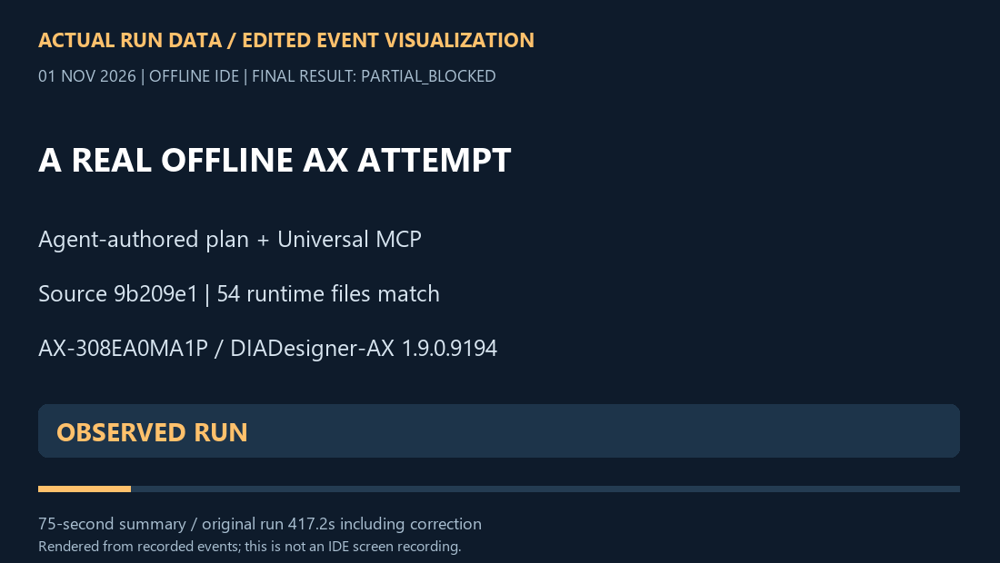

# An actual AX run: plan, project, compiler feedback

**1 November 2026 · PARTIAL_BLOCKED · offline IDE only.**

The agent created a new neutral AX project through the **real Universal MCP stdio interface**, revised the called ST program, saved/reopened/read it back, inspected real compiler errors and corrected its own input. The compiler then reported **0 errors / 0 compiler warnings**. The unchanged MCP acceptance gate still rejected **21 missing-device-description environment warnings**. No accepted frozen artifact was produced.

[75-second MP4](../../assets/showcase/ax-run-summary.mp4) · [Result image](../../assets/showcase/ax-run-result.png) · [Complete sanitized call index](../../examples/ax-showcase/evidence/actual-call-timeline.jsonl) · [Compiler receipts](../../examples/ax-showcase/evidence/compiler-receipts.json).

The media is a **condensed event visualization rendered from the actual run**, not an IDE screen recording, a simulator, or a replay-backend result. The original automatic attempts plus agent inspection/correction took **417.2 seconds**. User request to the recorded blocker was **966.2 seconds**, including setup/inspection before the run. A first accepted compiled candidate was **not produced**. Subsequent research, publishing and review time is additional; 75 seconds is the presentation length, not engineering execution time.

## What actually happened

| Stage | Observed result |
|---|---|
| Agent plan | [Neutral behavior and acceptance contract](../../examples/ax-showcase/evidence/contract.json); internal permit/counter, no mapped I/O |
| Public runtime identity | 54 core/backend/worker files match `9b209e1e559a726bdce12450c48af56b60ed6cc8` |
| Native project creation | PASS: new AX-308EA0MA1P project, called `Demo_PRG`, cyclic task 20 ms; save/reopen/device/task/source checks |
| ST read/revision | PASS: exact source readback and revision-bound candidate; no runtime patch |
| Initial vendor build | Compiler found 2 errors: the generated `Limit` variable collided with built-in `LIMIT`; 21 environment warnings also present |
| Agent correction | Renamed only the neutral ST variable to `CountLimit`; revision 2 saved/reopened; input and source-readback digests match |
| Corrected compiler result | `Compile complete -- 0 errors, 0 warnings` |
| MCP build acceptance | **BLOCKED**: 21 environment warnings remain; job status `failed` |
| Freeze / planned syntax-negative / native Ladder / recovery | **NOT_RUN** after the failed acceptance gate |
| PLC discovery, online, download, RUN/STOP/watch, physical or cyclic behavior test | **NOT_RUN**; this task did not contact a PLC |

The first input mistake was **observed compiler feedback**, not the separately planned controlled syntax-error test. The latter and its restoration remain NOT_RUN. Readback verifies saved source; it is not a runtime behavior test of the counter. The planned Ladder recipe is included explicitly as NOT_RUN.

## Exact run identity

- Target: **AX-308EA0MA1P**.
- IDE: **DIADesigner-AX 1.9.0.9194**, profile `DIADesigner-AX 1.9` (the exact spaced profile string is in the summary).
- ScriptEngine: **4.0.0.0**. Device ID `16f7 0319`, version `1.0.9.2`.
- Source: [public commit 9b209e1](https://github.com/ufukefekaya-tr/delta-plc-agent/tree/9b209e1e559a726bdce12450c48af56b60ed6cc8); core/AX 0.4.0 execution source is unchanged by this presentation update.
- Corrected build: revision 2, job `e89f4e0a-10bf-4d05-b7c9-57c2afa7cab2`.
- Corrected project SHA-256: `a9724e5fbb5798eada53fe706d39b060a61a27a3ded3bc34cfe2224d91f3530f`.

[Detailed summary/tool hashes](../../examples/ax-showcase/evidence/summary.json) · [54 source pins](../../examples/ax-showcase/evidence/public-source-pins.json) · [Actual event timeline](../../examples/ax-showcase/evidence/timeline.json) · [Publication manifest](../../examples/ax-showcase/evidence/manifest.json) · [Showcase verification](SHOWCASE_VERIFICATION.json).

The source pins were independently rechecked against Git blobs when these files were imported. The source→reopened revision→compiler result identity is retained. Exact neutral input/receipt bytes are preserved in Git, including their original line endings. The evidence directory's `.gitattributes` prevents automatic newline conversion from invalidating those hashes.

## Reproduce

Start with [host preparation and the exact typed sequence](../../examples/ax-showcase/evidence/REPRODUCE.md). Use the [AX backend setup](../../backends/ax/README.md) and [runbook](../../backends/ax/docs/AX_RUNBOOK.md) with **your own** installed vendor executable, ScriptEngine, device catalogue and hashes. Deployment autostart stays disabled; the target list is empty. The common file workspace and native AX workspace are distinct handles.

The agent supplies the engineering plan. The optional [engineering skill](../../skills/delta-plc-engineering/SKILL.md) documents model/tool selection and result review; `workflow.run` executes explicitly supplied typed steps and is not a natural-language program designer. The run used agent-authored planning and existing public MCP operations.

Preparation is one-time host work; the recorded operations needed no human menu steps. AX launches a hidden full vendor runtime for OEM compiler services and executes ScriptEngine workers. This is not a claim that the vendor was started with `--noUI` or that no vendor process exists.

No customer seed, private worker, device-slot alteration, warning waiver or runtime feature patch was used. The open environment blocker is the exact missing-device-description warning above. This presentation task does not modify device catalogues or weaken the existing acceptance policy to make a green demo.

## What is published

The allowlisted evidence contains the neutral initial/fixed/NOT_RUN inputs, source/tool identities, 116-call sanitized index, compiler receipt excerpts and reproduction notes. The index covers every call including job polling; it does **not** expose the full private request/result bodies. Their hashes are retained. Native project binaries, vendor caches/logs, host paths and private process records are not distributed.

The final typed shutdown receipt was unconfirmed; later read-only liveness checks observed owned workers exited through existing idle handling. This is not presented as a successful recovery or typed-shutdown demonstration.

## Keep history visible

This new attempt is separate from the [11 October environment-blocked native chain](../../backends/ax/qualification/native-public-chain-2026-10-11.json) and [AX 0.4 publication validation](../public/AX_0_4_VALIDATION.md), whose native/live stages were NOT_RUN for that release exercise. Those files remain unchanged. A later successful qualification would require its own exact model/profile, run identity and evidence.

## Türkçe kısa sonuç

Yeni nötr AX projesi gerçek MCP üzerinden oluşturuldu. ST revizyonu, kaydet/yeniden aç ve kaynak geri okuma geçti. Ajanın `Limit` ismi compiler tarafından reddedildi; ajan yalnız örnek kodu `CountLimit` olarak düzeltti. Compiler 0 hata / 0 compiler uyarısı bildirse de 21 eksik cihaz tanımı ortam uyarısı MCP kabulünü durdurdu. Sonuç **PARTIAL_BLOCKED**; freeze, planlı negatif test, native Ladder, recovery ve fiziksel çalışma yapılmış sayılmaz. GIF/MP4 gerçek çağrı kayıtlarının 75 saniyelik olay görselleştirmesidir; IDE ekran kaydı değildir.
